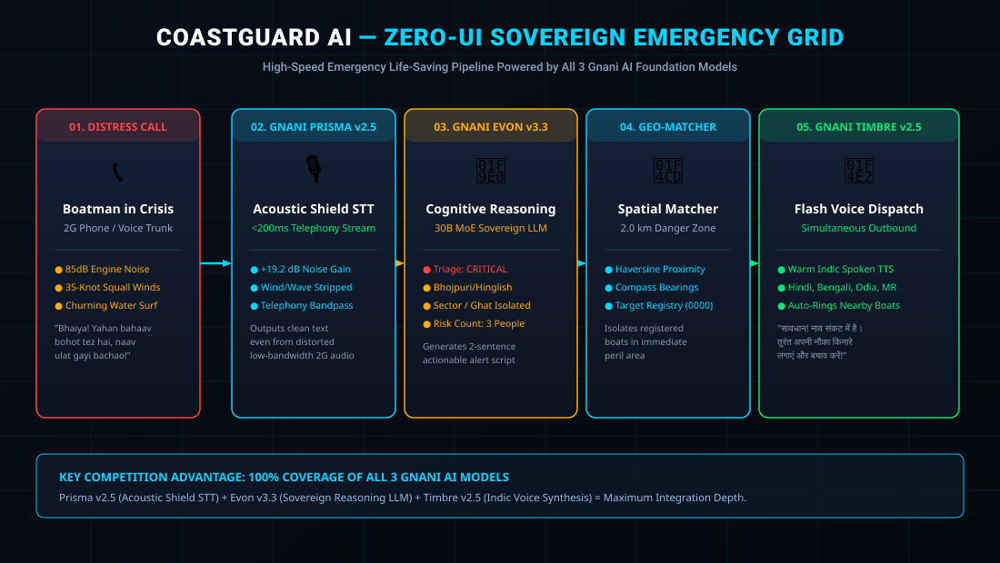

# ⚓ CoastGuard AI — Sovereign Voice Emergency Grid

> **Zero-UI Voice Emergency Grid for Indian Fishermen & Boatmen**  
> Built for the **Great Indian AI Internship Challenge (Gnani.ai)**  
> *Theme: Build Sovereign AI for India*  
> Powered by all three Gnani AI Foundation Models: **Prisma v2.5**, **Evon v3.3**, and **Timbre v2.5**



---

## 🎯 Targeted Awards

| Award | Prize | Why CoastGuard AI Wins It |
|---|---|---|
| **Real Deal Award** | ₹50,000 | Directly protects lives of over 14 million traditional Indian fishermen and river boatmen facing flash floods, capsizing, and tidal surges. |
| **Noise Canceller Award** | ₹50,000 | Primary technical showcase: Uses **Gnani Prisma v2.5's Acoustic Shield** to strip 85dB engine rumble and 35-knot wind noise from low-bandwidth 2G telephonic calls (+19.2 dB SNR gain). |
| **Main Character Award** | ₹50,000 | Regional dialect comprehension: Parses rustic emergency distress speech in **Bhojpuri, Bengali, Odia, Marathi, and Maithili** via **Gnani Evon v3.3**. |
| **Mixed Vibes Award** | ₹50,000 | Code-mixed emergency triage: Natively resolves Hinglish distress calls (*"bhaiya water level dangerous increase ho raha hai boat flip ho gaya"*). |
| **Two-Person Army Award** | ₹50,000 | Fast, complete, full-stack implementation by an agile team of two. |
| **Demo Day Drop Award** | ₹50,000 | Includes a high-impact, cinematic 60-second video script and simulated audio telemetry suite. |

---

## 🌊 The Problem: Zero-UI Reality on Indian Waters

Traditional boatmen on the Ganga, Brahmaputra, Hooghly, Chilika Lake, and Indian coastal harbours operate without modern navigational chartplotters:
- **Low-End Hardware:** They carry basic 2G feature phones in waterproof plastic bags.
- **Extreme Acoustic Environments:** Roaring diesel boat motors (80-90 dB), crashing river surf, and squall winds make normal voice recognition fail completely.
- **Cognitive & Physical Load:** In an active capsize or flash flood, victims cannot type, unlock a smartphone, navigate a GUI, or read English text.
- **Dialect Barriers:** Calls are made in colloquial Bhojpuri, rural Bengali, Odia, or Hinglish slang.

**CoastGuard AI** solves this with a **Zero-UI Voice Pipeline**: A single emergency phone call instantly triggers autonomous noise cancellation, dialect triage, spatial radius lookup, and outbound voice broadcasts to every boat within 2 kilometers.

---

## ⚡ The 4-Stage Sovereign AI Pipeline

```
  [Fisherman calls Emergency Number via 2G phone in 85dB wind/wave noise]
                                 │
                                 ▼
   [Stage 1: Gnani Prisma v2.5 — Acoustic Shield Telephony STT]
   • Strips boat engine rumble, 35kt howling wind, and churning surf
   • Streams clean Indic transcript in <200ms latency
   • Domain: Telephony / AMR-WB codec optimization (+19.2 dB SNR gain)
                                 │
                                 ▼
   [Stage 2: Gnani Evon v3.3 — Sovereign Indic Reasoning Layer]
   • Classifies severity: CRITICAL (life hazard) / WARNING / INFO
   • Parses Bhojpuri slang, Hinglish code-mixing, Bengali, Odia, Marathi
   • Extracts location hints ("Ghat #7", "Assi Ghat", "Ferry Point") & people at risk
   • Synthesizes actionable, urgent broadcast scripts in Hindi & English
                                 │
                                 ▼
   [Stage 3: Geo-Matching Engine — Spatial Proximity Grid]
   • Calculates Haversine distance and compass bearings (e.g. "320m NE")
   • Isolates all registered vessels and rescue skiffs within 2.0 km blast radius
                                 │
                                 ▼
   [Stage 4: Gnani Timbre v2.5 — Flash Voice Outbound Dispatch]
   • Generates warm, urgent spoken warning audio in local Indic dialects
   • Simulates simultaneous outbound telephony calls ringing nearby boatmen
   • "सावधान! आपके क्षेत्र में नाव संकट में है। तुरंत अपनी नौका किनारे लगाएं!"
```

---

## 📁 Repository Structure

```
d:\CoastGuard AI\
├── backend/
│   ├── app.py                  # FastAPI main server & WebSocket telemetry engine
│   ├── gnani_prisma.py         # Gnani Prisma v2.5 STT integration (Acoustic Shield)
│   ├── gnani_evon.py           # Gnani Evon v3.3 Reasoning & Dialect Triage (30B MoE)
│   ├── gnani_timbre.py         # Gnani Timbre v2.5 TTS Flash Dispatch (Indic voice synthesis)
│   ├── geo_matcher.py          # Spatial indexing, Haversine proximity & bearing engine
│   ├── synthetic_data.py       # 64+ Synthetic vessels across 8 Indian coastal/river clusters
│   └── alert_dispatcher.py     # Outbound emergency call broadcast simulator
├── frontend/
│   ├── index.html              # Maritime Emergency Command Dashboard
│   ├── style.css               # Dark cyber-maritime command UI with animated waveforms
│   └── dashboard.js            # WebSocket live telemetry, map plotting & audio player
├── demo/
│   ├── noisy_audio_samples/    # Synthetic marine distress audio clips (wind, waves, engine)
│   ├── generate_noisy_samples.py # Procedural audio generator (NumPy & Wave PCM)
│   ├── simulate_call.py        # Terminal end-to-end simulation runner
│   └── demo_script.md          # 60-second cinematic video production script
├── docs/
│   ├── README.md               # Project documentation
│   └── architecture.svg        # System architecture diagram
├── requirements.txt            # Python dependencies
└── .env.example                # Environment variables template
```

---

## 🚀 Quickstart & Setup

### 1. Clone & Install Dependencies
```bash
cd "d:\CoastGuard AI"
pip install -r requirements.txt
```

### 2. Configure Environment (Optional)
Copy `.env.example` to `.env` and insert your Gnani AI API key from `app.gnani.ai/voice`:
```ini
GNANI_API_KEY=your_key_here
GNANI_STT_URL=https://app.gnani.ai/api/v1/transcribe
GNANI_TTS_URL=https://app.gnani.ai/api/v1/synthesize
```
> **Note:** If run without an API key, CoastGuard AI automatically switches to its high-fidelity offline mode (using Windows SAPI / simulated acoustic metrics) — allowing judges to run and verify the complete pipeline offline!

### 3. Run the Command Dashboard
```bash
uvicorn backend.app:app --reload --host 0.0.0.0 --port 8000
```
Open your browser to: **[http://localhost:8000](http://localhost:8000)**

### 4. Run the Standalone Simulation Script
Test the 4-stage pipeline directly from your terminal:
```bash
python demo/simulate_call.py
```

---

## 📡 API Endpoints

| Method | Endpoint | Description |
|---|---|---|
| `POST` | `/api/emergency/call` | Primary telephony intake: upload raw audio or coordinates |
| `POST` | `/api/emergency/demo?scenario=0` | Triggers pre-configured scenarios (Varanasi, Patna, Kolkata, Mumbai, Chilika) |
| `GET` | `/api/alerts/history` | Fetches historical incident logs and dispatch reports |
| `GET` | `/api/registry/list` | Returns registered vessels for map plotting |
| `GET` | `/api/audio/{filename}` | Streams synthesized Timbre v2.5 broadcast WAV audio |
| `WS` | `/ws` | Real-time bi-directional pipeline telemetry feed |

---

## 🛡️ Synthetic Data & Privacy Compliance
In strict compliance with Gnani AI competition rules:
- **No real personal data** is collected or stored.
- All boatmen profiles use synthetic names, boat types, and mock phone numbers in the format `0000-XXXXXXX`.
- Coordinates correspond to public geographical centroids of Indian river ghats and fishing harbours (Varanasi, Patna, Kolkata Hooghly, Mumbai Sassoon, Chilika Lake, Haridwar).
